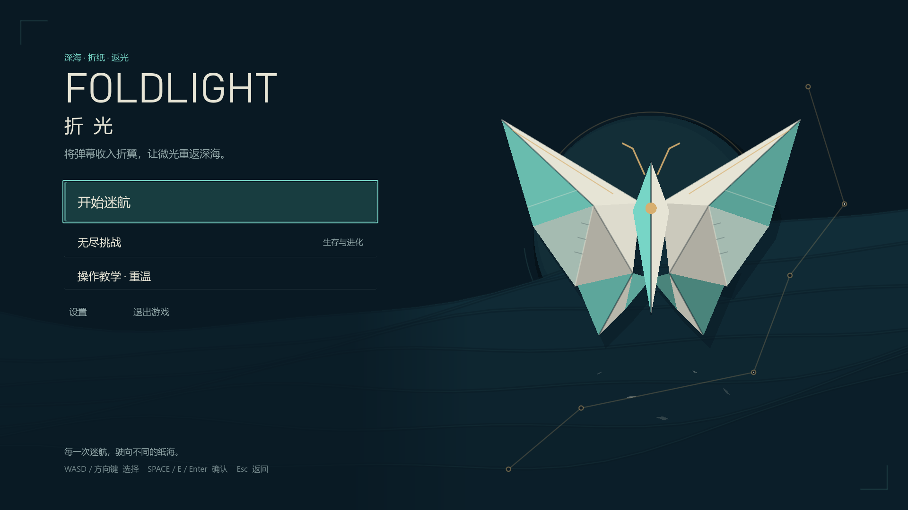
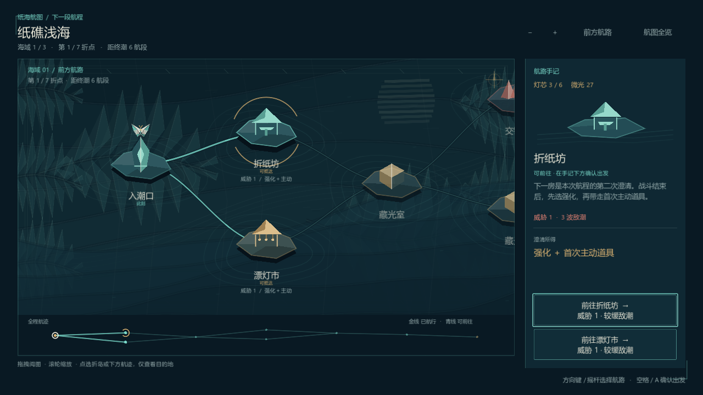
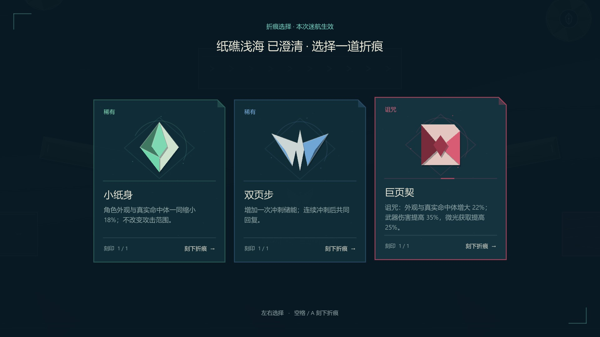

# FOLDLIGHT · 折光

收下光，再还回去。一款以**迷航肉鸽**为主线的纸海弹幕游戏。



## 统一的纸海

当前分支是 `3.10.0-dev` 重构预览。自动武器负责开火；你负责移动、冲刺、按住折域收纳弹幕，再松开返光。黑芯金边弹不可反射。

| 入口 | 内容 |
| --- | --- |
| 开始／继续迷航 | 分支房间、局内强化与区域首领；首次进入附操作教学 |
| 无尽挑战 | 开放纸海、生存进化与任务奖励 |

迷航与无尽直接复用同一套玩家操作、战斗 HUD、三选一、暂停、设置和结算组件；好友生存保留无尽玩法与联网计分。三章十二航故事模式已移除，旧故事存档字段保留兼容读取。标题纸蛾、玩家、纸礁与灯台采用程序化矢量绘制。像素 Demo 保留在独立场景和导出预设中。

迷航的普通战斗房横向扩展到 3360 像素，两侧「引潮灯」可在靠近并按住折翼后吸收附近可反射敌弹，每灯每房使用一次。无弹或收纳已满时不会消耗，黑金弹仍不可收纳。灯台、沿岸纸礁与潮流都有动态反馈。

纸海航图采用大幅地图与右侧「航路手记」：默认聚焦前方航路，保留拖拽、缩放、全览与底部航迹导航。手记显示灯芯、微光、目的地、敌潮波数和真实奖励类型；远方节点仅可预览，确认可达节点后才会出发。航图展开后等待旧输入释放，避免选完奖励时连按进入下一关。三选一保留纸雕图腾、错峰展开、焦点浮起和确认折光。

迷航与无尽的三选一共用输入保护：卡片展开后至少留出 1 秒阅读时间，待旧按键、鼠标及摇杆释放后才开放选择。释放刚才的战斗按键不会触发领取，需重新按下确认。

迷航首领击破后会保留当前战场与零血量首领条，清除残留威胁，至少展示 2.2 秒收尾。松开旧输入后，再按确认或点击继续才前往下一片海域或查看最终结算；这一停留阶段可恢复存档，不会重打首领或重复发放收益。

地图升级前的 Boss 修复版单独保存在 [`backup/boss-fixed-before-map-20261015`](https://github.com/9191aaa/FOLDLIGHT/tree/backup/boss-fixed-before-map-20261015) 分支。对应网页已留存为 Sites 版本 4，可恢复到原网址；此检查点包含已有的好友房间与意见反馈入口。

战斗反馈区分短促普通命中、青金返光撕纸与击破碎片，连发合并反馈，避免连续白闪遮住弹幕。自身受伤使用珊瑚红裂痕和来袭方向提示，无敌期间保持飞蛾与真实判定点可见；无尽也接入收弹、返光、命中与受伤音效，受伤音优先。震屏设为零时关闭玩家反冲，仍保留受伤颜色和方向提示。

网页版音乐改为提前生成的双层循环，随战斗强度平滑叠加，避免密集战斗时实时供样断音。纸屑音效柔化高频，开场与胜利音的换音和尾部平滑衔接；音效池满时舍弃多余提示，保留专用受伤声部，避免强行截断正在播放的声音。

普通关现在随航路深度增加敌人组合与增援压力，休息和补给房保留缓冲。首领减少弹幕叠加、延长预警和返光窗口，并修复预警后重新瞄准、转阶段吞掉硬直及「双折」升级后打空的问题。配置与测量方式见 [难度曲线记录](foldlight/docs/godot-prompter/plans/difficulty_curve.md)。

地形采用跨海域一致的颜色与纹理：青绿日纹加速回息和移动，紫色湿墨压低回息，红色刺纸造成接触伤害，蓝色潮流沿箭头推移。靠近区域时显示简短效果提示；进入时边缘增强，危险范围与实际判定一致。敌人留下的临时缚折圈使用独立收束纹，标明降低移速。

三片海域的中央战斗区域加入沉水纸礁、倒悬书页与断日祭阶，实体掩体采用分片折面和纸层侧缘，无尽地图各区以不同地标连接。静态海底独立缓存，局部潮光与游动水痕单独更新；地貌装饰可穿过，明亮边界仍对应真实效果区。无尽占领圈与实际占领范围保持一致。




## 运行与构建

使用 **Godot 4.6.3** 打开 `foldlight/project.godot`，按 F5 运行项目，或使用命令行：

```powershell
godot --path ./foldlight
godot --headless --path ./foldlight --export-release "Windows Desktop"
```

Windows 输出为 `foldlight/build/FOLDLIGHT_Refactor_Windows/FOLDLIGHT.exe`。预览导出使用独立的 `FOLDLIGHT Refactor Preview` 存档目录，可与已有版本共存。需要对应版本的导出模板；构建产物不提交到 Git。

新增 `Web` 单线程导出预设，输出 `foldlight/build/FOLDLIGHT_Web/index.html`。网页版包含完整游戏、中文字体和音频兼容；浏览器存档与桌面隔离。构建与托管说明见 [Web 导出](foldlight/docs/WEB_EXPORT.md)。

好友生存赛通过网页房间发起：双方加载完成后统一倒计时，以相同种子和基础机体开始各自的真实无尽战斗，按有效战斗时间比成绩。选奖励时停表，手动暂停禁用；退出、刷新或断线超过 30 秒判负。网页负责房间与计分同步，游戏通过 `WebRaceBridge` 上报真实数据。房间协议见 [网页竞赛](foldlight/docs/WEB_RACE.md)。

## 操作

| 动作 | 键盘 | 手柄 |
| --- | --- | --- |
| 移动 | WASD／方向键 | 左摇杆／十字键 |
| 收纳／返光 | 按住／松开空格或 E | 按住／松开 A |
| 冲刺 | Shift | B |
| 主动道具 | Q | X |
| 暂停／继续 | Esc | Start |

两模式的菜单均支持 WASD／方向键、左摇杆／十字键选择，Enter／空格／E／A 确认。Esc／B 返回上一层，Esc／Start 暂停或继续；M 静音。暂停菜单提供继续、设置和结束本局。好友竞赛不可手动暂停，奖励选择期间停止计时。

## 开发与验证

```powershell
./foldlight/tools/check_refactor.ps1 -GodotPath 'C:/path/to/godot.exe'
# 扫描全部历史集成测试，包含独立 Demo
./foldlight/tools/check_refactor.ps1 -GodotPath 'C:/path/to/godot.exe' -All
# 仅运行指定回归（仍先做项目导入）
./foldlight/tools/check_refactor.ps1 -GodotPath 'C:/path/to/godot.exe' -SelectedTests test_weapon_volley_accuracy,test_rogue_pressure_curve
```

每个测试使用独立用户数据目录，不接触玩家存档。日志在 `foldlight/build/refactor-checks/`。

本次地图升级通过流程、存档、地形、奖励输入与航图预览回归，并检查实际 GPU 画面。满弹压力场景的绘制次数由初版新图的 2577 降至 1933，低于 2000 次预算。该场景帧时仍未达到 60 fps 门槛：本机升级前平均 / P95 为 29.41 / 44.91 ms，最终版为 28.69 / 44.99 ms；没有降低测试阈值。测试包含实时敌人和弹量变化，这些数值用于记录本次验证，不代表所有设备的帧率。

主要职责边界：

- `scripts/ui/foldlight_theme.gd`：共享颜色、字体、控件样式。
- `scripts/roguelite/ui/rogue_title_screen.gd`：主菜单构图与动作信号。
- `scripts/roguelite/rogue_session_controller.gd`：迷航流程与存档协调。
- `scripts/visuals/paper_art.gd`：共用纸蛾和纸海绘制。
- `scripts/ui/input_contract.gd`：共用操作绑定、导航与提示。
- `scripts/roguelite/ui/rogue_presentation.gd`：迷航与无尽共用的 HUD、奖励、暂停、设置和结算。
- `scripts/game.gd`：轻量应用入口，不再载入旧故事战斗或旧 HUD。
- `scripts/endless/endless_slice_runtime.gd`：无尽任务、生存成长与竞赛适配，共用玩家、战斗和界面组件。

范围与验证说明见 [重构记录](foldlight/docs/godot-prompter/plans/unified_refactor.md)。修改请提交分支和 PR。MIT 许可证见 [LICENSE](LICENSE)。
