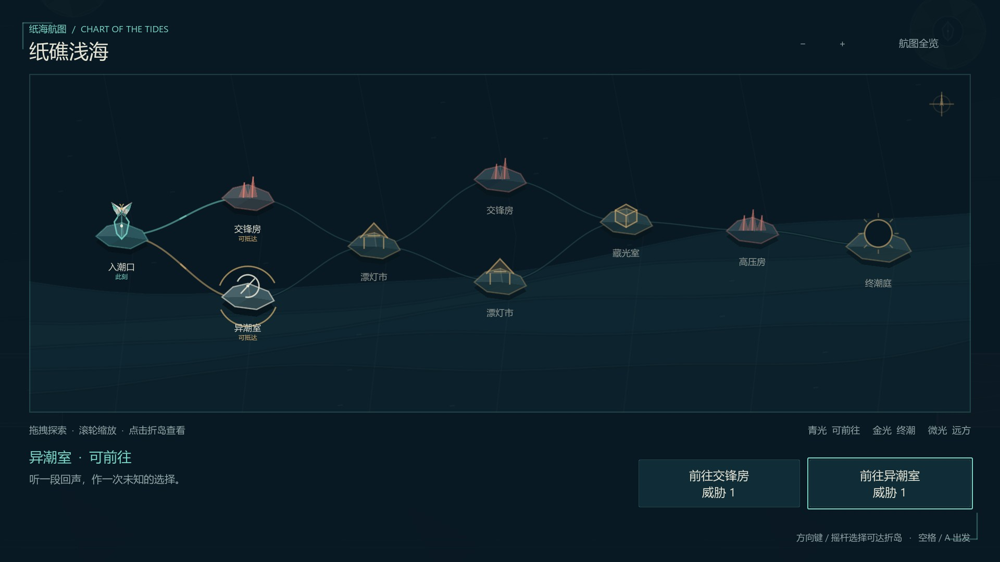

# FOLDLIGHT · 折光

收下光，再还回去。一款以**迷航肉鸽**为主线的纸海弹幕游戏。


## 统一的纸海

当前分支是 `3.10.0-dev` 重构预览。自动武器负责开火；你负责移动、冲刺、按住折域收纳弹幕，再松开返光。黑芯金边弹不可反射。

| 入口 | 内容 |
| --- | --- |
| 开始／继续迷航 | 分支房间、局内强化与区域首领；首次进入附操作教学 |
| 故事航路 | 原有三章十二航战役与潮界检查点 |
| 无尽挑战 | 开放纸海、生存进化与任务奖励 |

三个入口共用深海墨、纸白、折光青与旧金的视觉语言。标题纸蛾、玩家、纸礁与灯台采用程序化矢量绘制。像素 Demo 保留在独立场景和导出预设中。

迷航的普通战斗房横向扩展到 3360 像素，两侧「引潮灯」可在靠近并按住折翼后吸收附近可反射敌弹，每灯每房使用一次。无弹或收纳已满时不会消耗，黑金弹仍不可收纳。灯台、沿岸纸礁与潮流都有动态反馈。

纸海航图可以拖拽探索、滚轮缩放、悬停或点击查看折岛；远方节点仅可预览，确认可达节点后才会出发。三选一改为有纸雕图腾的折痕卡，加入错峰展开、焦点浮起和确认折光。

普通关现在随航路深度增加敌人组合与增援压力，休息和补给房保留缓冲。首领减少弹幕叠加、延长预警和返光窗口，并修复预警后重新瞄准、转阶段吞掉硬直及「双折」升级后打空的问题。配置与测量方式见 [难度曲线记录](foldlight/docs/godot-prompter/plans/difficulty_curve.md)。




## 运行与构建

使用 **Godot 4.6.3** 打开 `foldlight/project.godot`，按 F5 运行项目，或使用命令行：

```powershell
godot --path ./foldlight
godot --headless --path ./foldlight --export-release "Windows Desktop"
```

Windows 输出为 `foldlight/build/FOLDLIGHT_Refactor_Windows/FOLDLIGHT.exe`。预览导出使用独立的 `FOLDLIGHT Refactor Preview` 存档目录，可与已有版本共存。需要对应版本的导出模板；构建产物不提交到 Git。

## 操作

| 动作 | 键盘 | 手柄 |
| --- | --- | --- |
| 移动 | WASD／方向键 | 左摇杆／十字键 |
| 收纳／返光 | 按住／松开空格或 E | 按住／松开 A |
| 冲刺 | Shift | B |
| 主动道具 | Q | X |
| 暂停／继续 | Esc | Start |

无尽暂停后可继续同一局，或主动结束挑战。故事地图／结算按 Esc 返回主菜单；战斗中先暂停，再按 C／LB 返回，保留最近的潮界存档。

## 开发与验证

```powershell
./foldlight/tools/check_refactor.ps1 -GodotPath 'C:/path/to/godot.exe'
# 扫描全部历史集成测试，包含独立 Demo
./foldlight/tools/check_refactor.ps1 -GodotPath 'C:/path/to/godot.exe' -All
# 仅运行指定回归（仍先做项目导入）
./foldlight/tools/check_refactor.ps1 -GodotPath 'C:/path/to/godot.exe' -SelectedTests test_weapon_volley_accuracy,test_rogue_pressure_curve
```

每个测试使用独立用户数据目录，不接触玩家存档。日志在 `foldlight/build/refactor-checks/`。

主要职责边界：

- `scripts/ui/foldlight_theme.gd`：共享颜色、字体、控件样式。
- `scripts/roguelite/ui/rogue_title_screen.gd`：主菜单构图与动作信号。
- `scripts/roguelite/rogue_session_controller.gd`：迷航流程与存档协调。
- `scripts/visuals/paper_art.gd`：共用纸蛾和纸海绘制。
- `scripts/campaign/story_content_catalog.gd`：故事文案、教义和敌人说明。
- `scripts/game.gd`：既有故事战斗及与统一主菜单的交接。
- `scripts/endless/endless_slice_runtime.gd`：无尽模式适配，共用玩家和战斗组件。

范围与验证说明见 [重构记录](foldlight/docs/godot-prompter/plans/unified_refactor.md)。修改请提交分支和 PR。MIT 许可证见 [LICENSE](LICENSE)。
