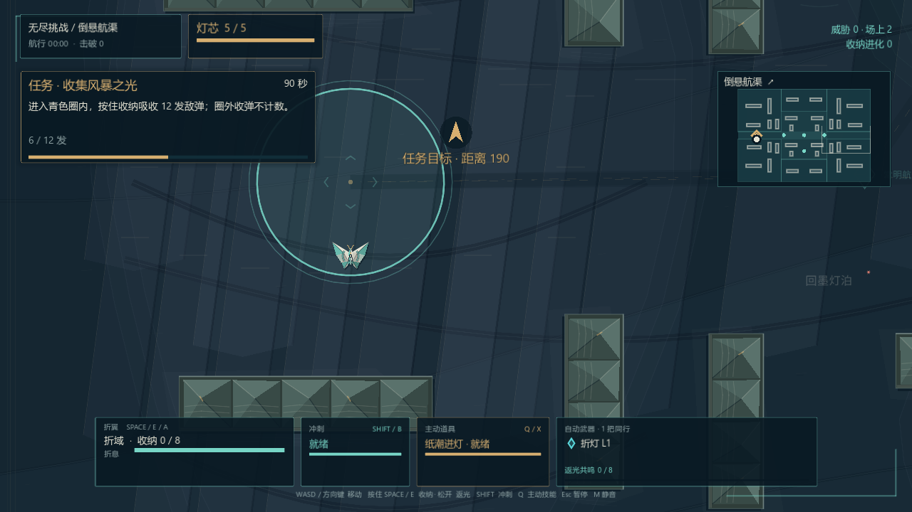
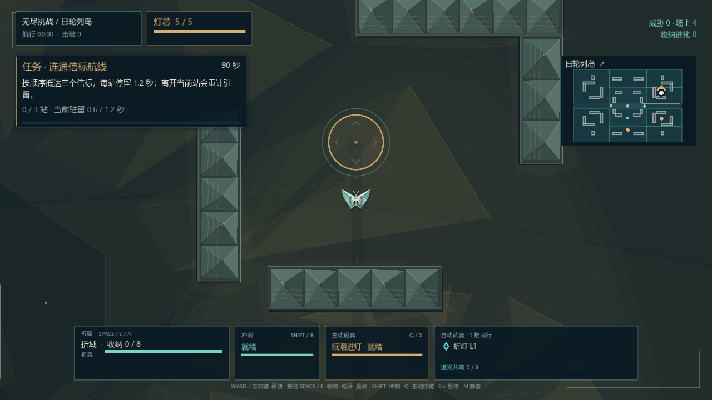

# 无尽任务互动与美术评估

评估日期：2026-10-17。基于本次 3.13 武器阵列工作区的实际场景、任务判定与地图资源。本文件提出后续方案；本次没有改动任务圈、地图材质或任务规则。

**建议升级，但先做“能看懂、会回应玩家的任务设施”，再做地图主题深化。** 当前问题不主要是地图太小或任务数量太少：六种任务已有不同判定，却大多共用空心圆；玩家的操作很少在任务所在地留下可见变化。再加一批任务或加粗光圈，难以解决这种距离感。

## 可复核的当前画面

下面是当前生产场景与绘制代码的原生截图。截图夹具设置任务类型、玩家位置及部分进度，并暂停战斗以便观察：它们是美术基线，不代表完整实战、难度或手机性能验证。导航指示也停留在夹具刷新时刻，不据此判定导航功能缺陷。

实际检查了三张地图的驻守、接力、收弹、摧毁任务共 12 个画面；这里保留两张代表性截图。底图已经有层叠纸张、沉水轮廓和不同地域配色，值得保留；任务圈与重复的绿色矩形墙体是目前更突出的薄弱部分。

## 两个直接根因

### 任务有判定，世界标记没有状态

[任务导演](../scripts/endless/endless_objective_director.gd) 已有六种任务，进度来自实际事件，并非全部只是站圈：

| 当前任务 | 现有判定 | 画面缺口 |
| --- | --- | --- |
| 驻守信标 | 半径 170，累计 12 秒；离开每秒退 0.35 秒 | 进入、退出、倒退和完成没有对应设施动作 |
| 击败队长 | 当前任务对应的唯一敌人被击败 | 与占领任务共用金色圈，攻击目标身份不够突出 |
| 摧毁火力旗 | 对真实旗帜目标造成 60 点实际伤害 | 已有旗帜实体与血条，但外层通用圈抢占视觉 |
| 连通信标航线 | 三站，每站半径 90、驻留 1.2 秒；离开当前站重置驻留 | 世界只画当前圈，接力链和已完成节点缺少实体表达 |
| 收集风暴之光 | 半径 240 内真实收纳 12 发敌弹；圈外不计 | 圈没有储光、吸收、满载反馈，主要靠读 HUD |
| 清剿敌群 | 记录 10 个不同实际敌人 ID | 无需任务圈，但目标进展缺乏局部反馈 |

[地图绘制](../scripts/endless/endless_handcrafted_map.gd) 的 `get_objective_marker_snapshot()` 只取位置、半径和颜色；`_draw_active_objective()` 始终画淡底、完整主圆、完整外圆。没有用进度驱动局部造型，完成或失败后直接不再绘制。这解释了为什么任务逻辑已有区别，实际体验仍像在不同大小的圆圈之间跑。

任务默认限时 90 秒，成功后间隔 4 秒；新任务只选开放区域，当前任务位置会受到关闭保护。这些已有约束应保留，不能只改美术却画出无法抵达的目标。

### 三张物理地图不同，部分前景样式被固定成纸礁

| 地图资源 | 世界尺寸 | 已有主题与空间特点 |
| --- | --- | --- |
| [折叠三角洲](../resources/endless/maps/folded_delta.tres) | 6144 × 4096 | 纸礁浅海，多方向交错通路 |
| [倒悬航渠](../resources/endless/maps/inverted_canals.tres) | 6400 × 4480 | 墨城，平行长航渠 |
| [日轮列岛](../resources/endless/maps/solar_archipelago.tres) | 6720 × 4480 | 日庭，围合庭院与折角墙 |

**三张地图的几何布局、碰撞和底图主题确实不同。** 但 [无尽运行时](../scripts/endless/endless_slice_runtime.gd) 向 `world.load_room()` 传入固定 `paper_reef`，`_build_room_terrain()` 又将每块墙的 `visual_style` 固定为 `paper_reef`。因此区域底图不同，近景墙材质与部分局部海面动效仍趋同；不能把这归结成“三张地图其实完全一样”。

[现有地形绘制](../scripts/roguelite/world/terrain_piece.gd) 已支持墨城的冷灰封印纹、日庭的暖金日轮纹、纸礁的层理。后续可先把真实 `map_definition.region_style` 接到这两处，再补地标，而不是推倒现有底图重画。

## 方案比较

| 方案 | 收益 | 代价与限制 |
| --- | --- | --- |
| 只美化光圈 | 低成本改善粗糙感 | 任务仍像地面标记，互动感提升有限 |
| **任务设施化，补局部反馈与地域前景** | 同时改善可读性、操作反馈和地图辨识度 | 需要设施状态动画；可先保留全部判定做小范围验证 |
| 全地图、角色、敌人一次性重制 | 视觉变化最大 | 资源量、性能与统一性风险较高，目前不优先 |

推荐第二项。保留深海纸雕方向：深水底色、少量纸张层次、折痕与灯芯；降低装饰纹理的对比，保证敌弹、玩家、危险区首先被看见。

## 第一阶段：六种任务长出自己的设施

这一阶段只改变表现，不改变伤害、时长、奖励或碰撞规则。原有准确作用半径保留为低亮边界，设施主体负责传达“做什么”和“做到哪一步”。

| 任务 | 建议造型与状态反馈 |
| --- | --- |
| 驻守 | 小型折纸灯塔。进入后灯瓣逐片展开，进度沿灯芯上升；离开时灯芯缓慢回落。完成后灯塔展开并短暂留亮。 |
| 接力 | 三座有编号的纸浮标。已完成浮标亮起，当前浮标展开，后续浮标保持空心轮廓；只突出当前与下一站，避免整张地图被发光连线占满。 |
| 收弹 | 带折翼叶片的集光风车。每次有效收纳让一片叶片点亮，中心储光变化与真实计数一致；圈外收弹不播放设施成功反馈。 |
| 火力旗 | 保留可受击实体，强化旗座、破损纸甲、命中裂纹与最终倒塌；移除竞争注意力的多层装饰圆。实际受击大小仍与现有碰撞一致。 |
| 队长 | 敌人身上带独有纸冠与任务飘带；以敌人身份与血条表达攻击目标，避免看起来像需要占领的地面设施。 |
| 清剿 | 保持战斗任务，不硬塞场地圈。合法击杀短暂点亮计数刻痕；连续击杀反馈合并，避免十次浮字和声音堆叠。 |

所有设施沿用“接近 → 进入/作用生效 → 进度变化 → 完成展开 → 奖励”的反馈顺序。完成动作建议约 0.35–0.6 秒，具体需与现有奖励展开保护共同验证，不能再造成奖励突然出现和误选。

颜色语义统一：青色表现收纳与有益状态，金色表现任务与进度，珊瑚红表现危险；同时使用灯瓣、裂纹、斜线、空心/实心等形状区分，不只靠颜色。关闭区的边缘和扣血提示必须比装饰更明确，不能被“更美”的海面纹理盖住。

手机不增加第三排常驻文字，也不新增交互按钮。现有任务栏、小地图、六武器图标条和摇杆已有各自位置；设施反馈放在世界中，并与敌弹错开亮度层次。新动画服从现有减弱动态设置。

## 第二阶段：先试一个真正改变操作选择的互动

**首选试点：让返光参与点亮信标。** 保留现有驻守推进，额外允许玩家在区域内返出实际收纳的弹幕以加快点灯。这样玩家会选择何时收、何时放、是否冒险留在信标附近，并能与本次武器阵列共鸣自然衔接。

供原型测试的初值：每累计返出 4 发有效弹幕增加 2 秒驻守进度，每个任务通过此方式最多增加 6 秒。它们是候选数值，尚未实现或验证；需要检查是否令任务太快、是否重复计算同一批弹幕，以及先在圈外蓄满后进圈释放是否符合预期。只消费权威战斗事件，不依赖视觉弹丸数量或动画结束回调。

后续再考虑接力完成后留下短暂、局部的有益航迹，让任务对场地有所影响。先做清楚的单一效果与固定长度，不直接取消整片关闭区，也不同时追加商店、采集、护送等新系统。第一项试点没有证实更有趣之前，不一起扩张。

这些玩法改动会改变好友竞赛规则，需再次更新联机规则版本并拒绝混版本房间；纯设施表现改进不需要为动画新增网络同步。

## 地图美术接下来改什么

1. **先修主题传递。** 让墨城、日庭的现有墙面语言真正出现在对应地图；测试主题变化不改变实际碰撞。
2. **补能记住的位置。** 每张图先做一个远景或不可交互地标，例如沉没档案塔、断裂日轮、层叠纸礁。地标位置服从通路与关闭区规则，不把大装饰画成可走却撞墙、或看似墙却可穿过。
3. **收敛底图噪声。** 近景设施精细，远景层叠更安静；保留现有纸张底图、区域斜线、常明通路。用地形材质和轮廓区分地图，不通过新增满屏粒子掩饰重复墙块。

## 实施边界与验收

当前静态海面已有缓存网格，局部水面有可见范围裁剪；这些应继续使用。任务导演是唯一判定来源，设施只是读取任务快照和信号，不复制一套计时或任务完成条件。

建议预算是“一个活动设施，接力最多三座浮标”，装饰更新限定在可见范围；新增小粒子设硬上限，先以不超过 24 个为目标。若需要贴图，先尝试一张共享 2048² RGBA 图集，未计压缩和 mipmap 时约 16 MiB；不额外增加全屏模糊或离屏渲染目标。这些是未来实现目标，不是本轮测得的性能结论。

验收需要同时覆盖：

- 三张真实地图、六类任务；进入/离开、进度回退、重置、完成、失败，以及区域关闭时任务仍可达。
- 桌面、844 × 390 横屏、360 × 780 竖屏网页外壳及横屏引导；设施不遮敌弹，HUD 不挤占摇杆和小地图。原生固定宽高比截图不能替代真实手机浏览器检查。
- 六武器同时攻击、共鸣、无尽最多 84 敌人、总投射物上限 260 的压力场景；对比改动前后帧时间与内存，连续十个任务和三张地图切换后不能持续增长。低端 Android 可先以稳定 30 FPS 为验证目标，但必须真机测量，不能用桌面截图保证。
- 现有网页双层音乐缓存与音效限流保持有效；设施声效不随每发弹幕无限叠加。
- 若修改互动规则，检查同种子好友赛两端判定一致；完成改动后仍交付验证过的 Windows EXE 与同签名 APK。

建议后续先做“灯塔 + 集光风车”两个代表设施的小场景原型，同时修正三地图主题传递。看清画面、操作反馈和手机成本后，再把经过验证的语言扩展到其余任务。
