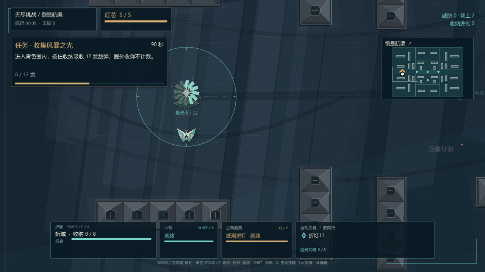
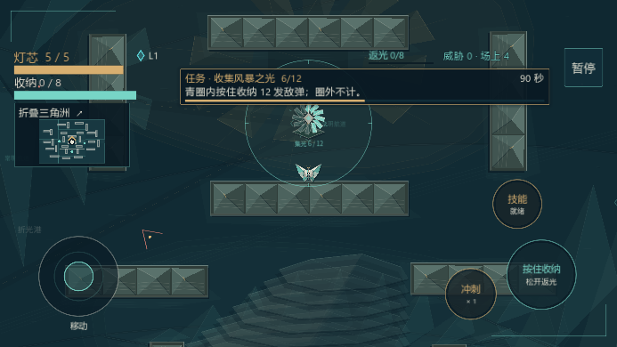

# 无尽纸雕设施 · 3.14

本次落实 [3.13 评估](ENDLESS_ART_ASSESSMENT.md) 中的任务设施、地域前景与返光互动。保留三张大地图、六类任务、动态封区、原有武器阵列与双成长路线；地图墙体位置、碰撞、任务作用半径和奖励交替顺序不变。

## 场景里的任务反馈

| 任务 | 新表现 |
| --- | --- |
| 驻守潮汐信标 | 纸雕灯塔、灯芯进度和展开灯瓣；四道刻痕显示返光蓄能 |
| 连通信标航线 | 三座编号浮标；当前站驻留展开，完成站点亮，后续站淡显 |
| 收集风暴之光 | 十二瓣集光风车，每片对应一发真正计入任务的敌弹 |
| 拆掉火力旗 | 真实可受击旗座随血量开裂、破损，击破后留下短暂折纸残片 |
| 击破敌方队长 | 纸冠与任务飘带跟随真实队长，不再画占领圈 |
| 清剿纸潮 | 合法击杀在玩家附近短暂点亮刻痕；没有虚构的任务地点 |

金色表示任务，青色表示收纳与有益状态，珊瑚红表示危险。驻守、接力、收弹仍分别保留半径 170、90、240 的低亮准确边界。设施只是读取任务导演的真实快照，不另算进度、命中或完成条件。

## 返光点灯

驻守仍需累计 12 秒，离圈每秒退回 0.35 秒。在同一任务期间，可先在圈外收纳，再进入圈内松开返光：每累计 4 发，增加 2 秒驻守进度；每任务最多增加 6 秒。剩余进度仍须驻守完成，不能反复离圈刷助燃额度。

只消费真实 Fold 释放事件。空放、圈外释放、已结束任务和重复释放序号不计数；圈外事件即使重新送入圈内也不能补领。任务 ID 防止上一任务或上一局的延迟事件影响新信标，单调序号去重不保留无限事件列表。点灯与武器阵列共鸣可以由同一次真实返光触发。

## 完成与操作

任务完成先冻结战斗，展示 0.5 秒设施收尾，再展开三选一。收尾和选择期间都不累计好友赛生存时间。奖励卡自身的一秒阅读与旧输入释放保护从卡片真正出现后单独开始，避免打完立即误选。

单人暂停、手机横屏提示、应用后台会保留未播完的收尾。死亡、结束比赛、返回标题和重开会取消旧任务的待领奖过程，不会在新场景突然弹出。关闭屏幕震动时保留进度、颜色和阅读时长，停止设施旋转、浮动与散开动作。

手机任务栏收紧为两行：标题带简短进度，下一行是当前操作提示；倒计时和进度条仍保留。桌面维持完整说明；不新增按钮或常驻第三排文字。

以上为生产场景的渲染截图；夹具设置任务进度并冻结战斗以比较美术，不能作为实战性能或难度证据。

## 三片海域

纸礁、墨城、日庭的真实主题现在传递到近景墙体和海面，配乐仍对应原先的纸礁、档案、日轮主题。三张图分别增加层叠纸礁、沉没档案塔和断裂日轮，作为低对比的海底地标；这些装饰没有碰撞，不改变通路或封区。

地标使用最多三份缓存网格并按屏幕可见范围裁剪，不逐帧生成几何。设施使用单独画布，普通动态更新最多每秒 20 次，新任务与完成切换立即更新；不会为任务动画重新绘制整张静态海底，也没有新增全屏模糊或音频声部。

## 联机与回退

由于返光点灯改变玩法，3.14 客户端规则为 `endless_race_v5`。后台继续承载 `v3` 和 `v4` 房间，但三个版本互相隔离；双方需使用相同版本。EXE、APK 和网页仍连接同一房间后台，同种子独立战场比较生存时间。

修改前的 3.13 提交 `1eb9ac9e72a47aac1015517771bd174cf585aec0`、本地分支 `backup/pre-endless-facilities-3.14` 和带版本的 EXE / APK 均保留。

新增回归覆盖返光计数与限额、真实返光完成任务时的弹幕和共鸣、完成过渡生命周期、三图主题与配乐、设施范围及缓存、地标不改变物理布局。设备、浏览器和压力验证的实际结果随本次发行说明交付；本机和安卓模拟器的结果不等同于所有实体手机或大陆运营商。

本机原生压力夹具将 84 个不死敌人集中在静止无敌玩家周围，同时保留约 260 枚弹幕。开启与关闭新增设施及地标时，帧间隔中位数分别约 163 / 162 ms，均明显掉帧；窗口为前台，非失焦限速。该极端负载不能称为性能达标，也未显示本轮美术引入明显额外回归。固定步探针中主要成本来自已有弹道和地形处理；本轮未降低敌人上限或改变战斗规则。三图循环重开 12 次、切换 72 次任务后，资源数保持 223，节点按地图保持 496 / 508，地标网格缓存保持 3 份。
